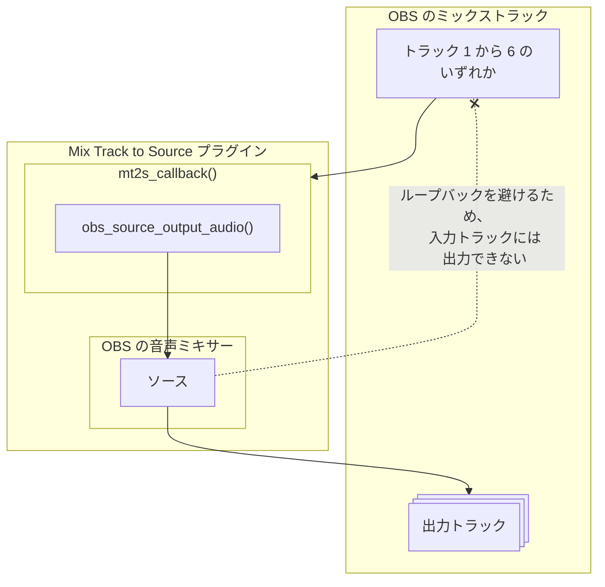
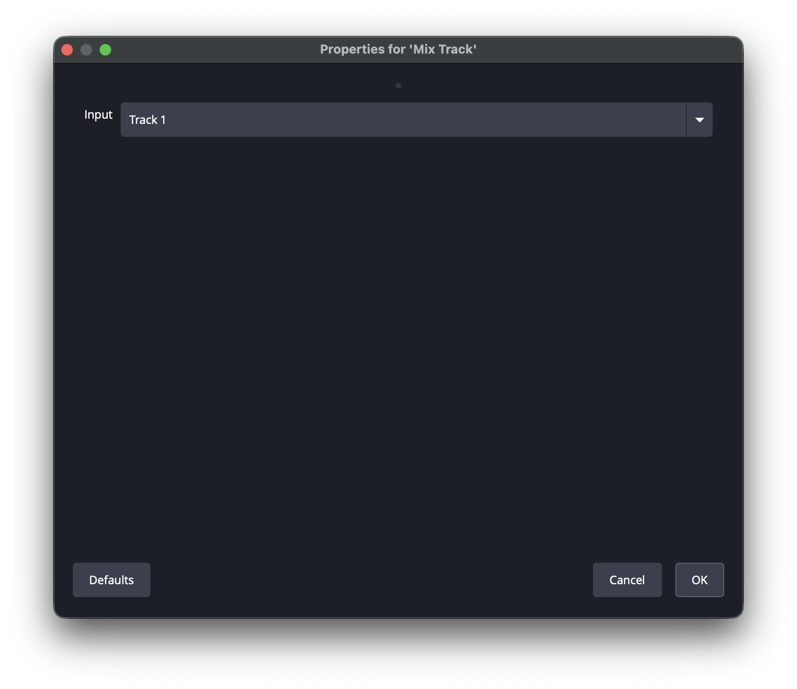
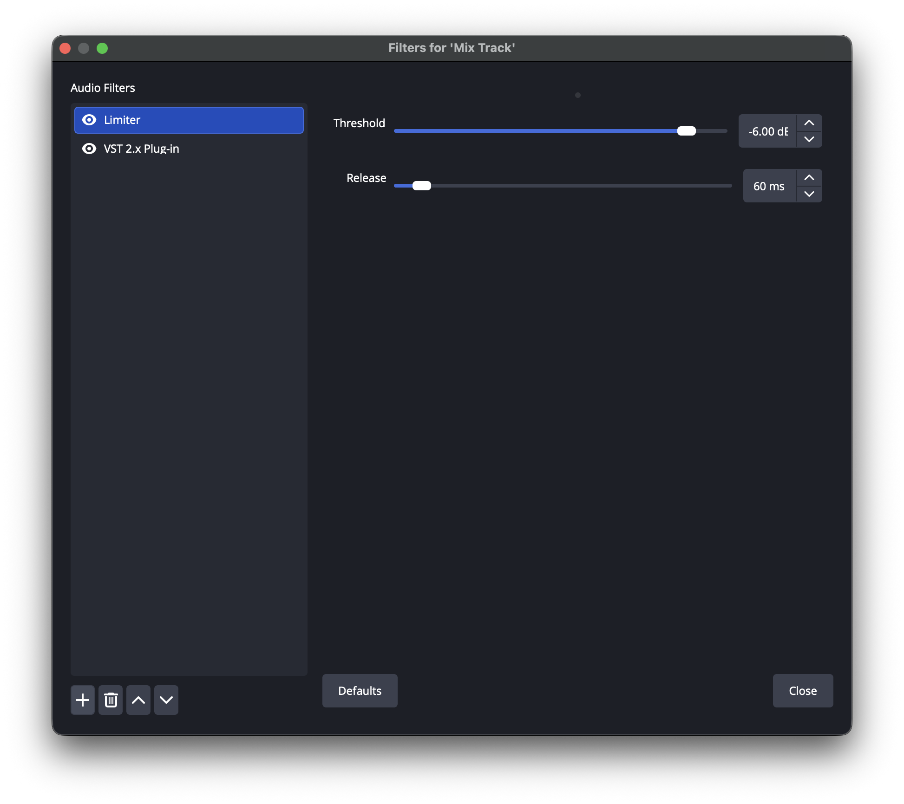
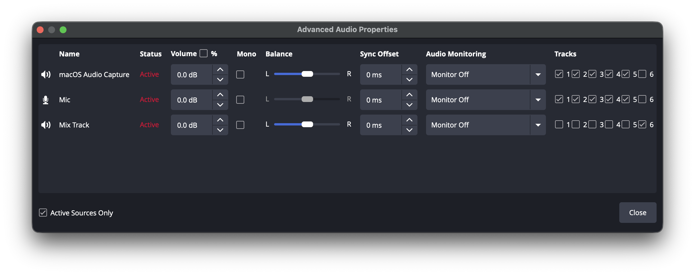
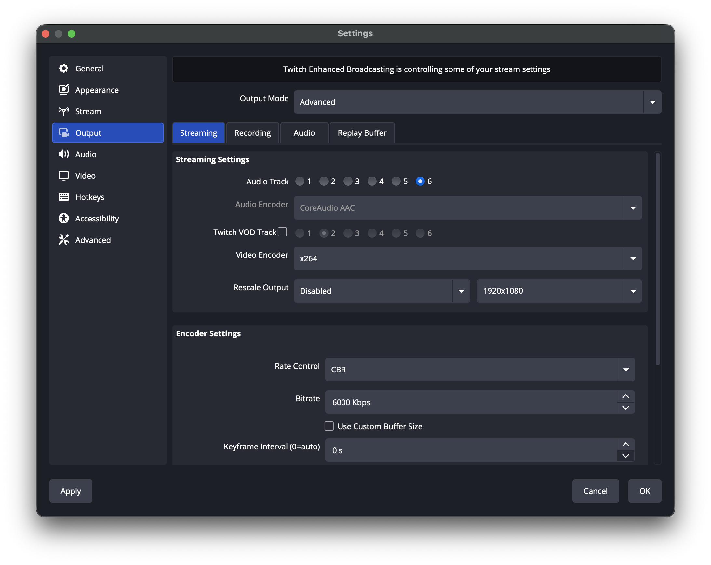

# Mix Track to Source

> For the English version, see [README.md](README.md).



- 入力にするミックストラックを選んで音声ソースを作成する
- 音声ソースは選んだミックストラックを入力とし、各種フィルタを適用できる
- 入力に選んだミックストラックを除き、ミックストラックを出力先に選べる
- 入力トラックへ音声を送っている他の音声ソースから、この音声ソースの出力トラックを自動で外し、音声が二重に出力されないようにする (他のミックストラックのソースは対象外)
  - 外したトラックは、この音声ソースを削除したときや入力・出力トラックを変えたときに元へ戻す。ただし、他のミックストラックのソースがまだ外す必要のあるトラックは戻さない
  - 利用者が手で戻したトラックには、以後触らない
  - 外した記録はシーンコレクションと一緒に保存される
- バッファリングにより、最小で 1024 サンプル (48 kHz で 21 ms) の遅延が生じる
  - これ以上の遅延を許容できない場合は、OBS の 設定 > 音声 > 詳細設定 で **低遅延音声バッファリングモード (Decklink/NDI 出力用)** を有効にする

## インストール

[Releases](https://github.com/semnil/MixTrack2Source/releases) ページからアーカイブファイルをダウンロードする。

### Windows

`mix-track-to-source-<version>-windows-x64-Installer.exe` を実行してインストールする。

または、アーカイブファイルを展開し、`mix-track-to-source` フォルダを次の場所に置く:

```
C:\ProgramData\obs-studio\plugins
```


### macOS

`mix-track-to-source-<version>-macos-universal.pkg` を実行してインストールする。


### Ubuntu

次のコマンドを実行する:

```
sudo dpkg -i mix-track-to-source-<version>-x86_64-linux-gnu.deb
```


## 使い方

- `ソース追加` > `ミックストラック` で音声ソースを追加する
- 入力に使うミックストラックを `トラック 1` から `トラック 6` の中から選ぶ
- 追加した音声ソースの出力先を オーディオの詳細プロパティ ウィンドウで選ぶ
  - 入力と出力に同じトラックは選べない
  - 入力トラックへ音声を送っている他の音声ソースからは、出力トラックが自動で外れる
    - 後から入力トラックへ音声を送り始めたソースは、この音声ソースの入力・出力トラックを変えるか、シーンコレクションを読み込み直すまで外れない。必要に応じて手で解除する

### 使用例

トラック 1 の入力にリミッターを適用し、その音声を配信用にトラック 6 へ出力する設定は次のとおり:






- 音声ソースを追加するときに、入力を トラック 1 にする
- その音声ソースのフィルタにリミッターを追加する
- その音声ソースのトラック 6 への出力を有効にする。トラック 1 へ音声を送っている他の音声ソースのトラック 6 への出力は自動で無効になる
- 設定 > 出力 > 配信 > 配信設定 > 音声トラック で トラック 6 を選ぶ


## 開発者向け情報

テンプレートリポジトリの情報を参照する。  
https://github.com/obsproject/obs-plugintemplate

### リリース

バージョンの定義元は `buildspec.json` の `"version"` だけで、リリースタグはそのバージョンそのもの (例: `1.0.3`。先頭に `v` は付けない)。
リリースするには、そのバージョン以外を何も変更しないプルリクエストをマージする:

1. `master` 上のマージコミットに対する `Push` ワークフローが成功すると、`Tag Release` ワークフローがそのコミットにバージョンのタグを付け、そのタグで `Push` ワークフローを実行する
2. タグでの実行がリリースパッケージをビルドし、下書きのリリースを作成する
3. [Releases](https://github.com/semnil/MixTrack2Source/releases) ページで下書きを確認して公開する

- バージョンの形式は `X.Y.Z` (例: `1.0.3`)。それ以外の形式では、ビルドが失敗する (CMake はバージョンに数字しか受け付けないため、`1.0.3-rc1` は拒否される) か、`Tag Release` がタグを push せずに失敗する
- バージョンを変更しない `master` への push では何も起きない。最初の親と比較されるコミットは、マージコミット、または rebase マージの最後のコミットである
- リモートに既に存在するタグは移動しない。そのタグが別のコミットを指している場合、`Tag Release` は失敗する
- 手で push したタグも同じリリース経路を通る
