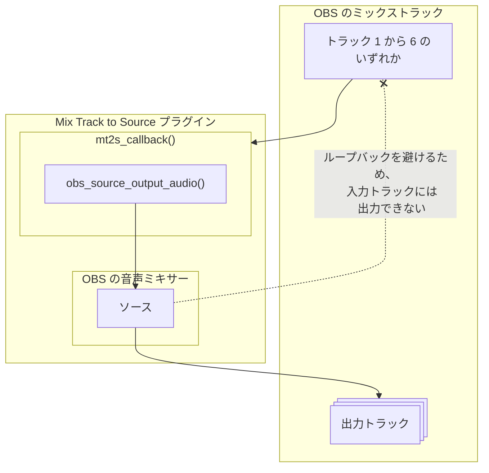
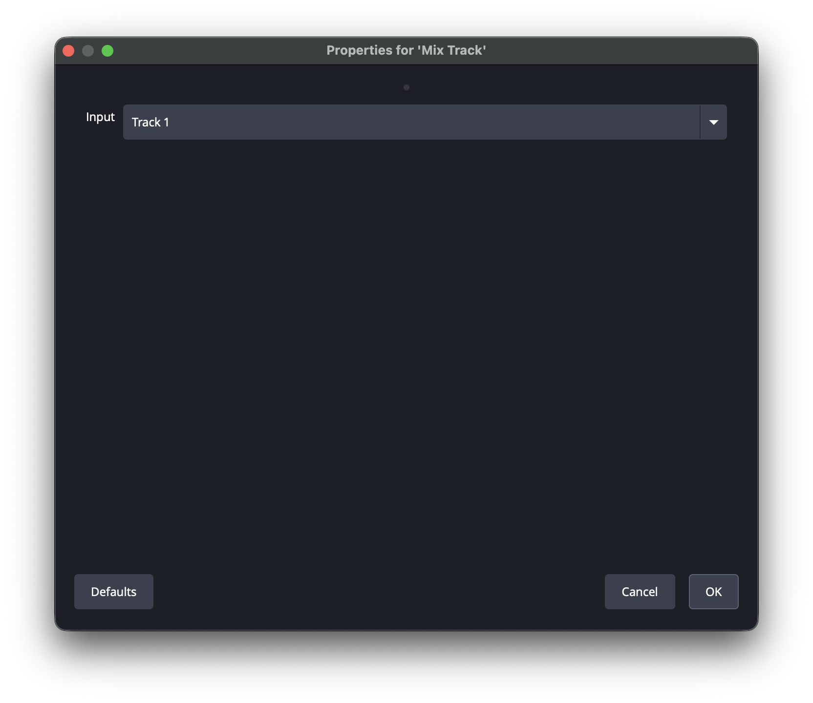
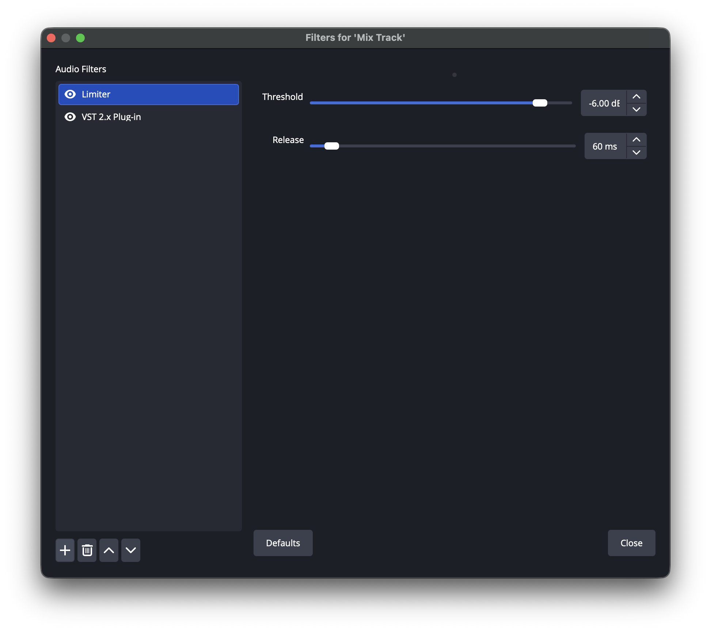
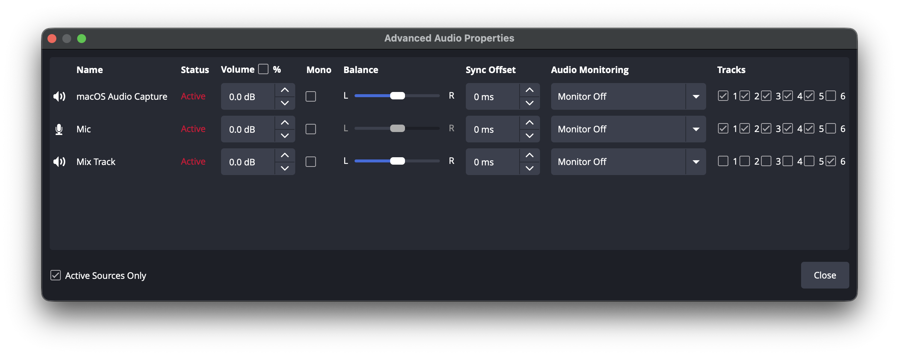
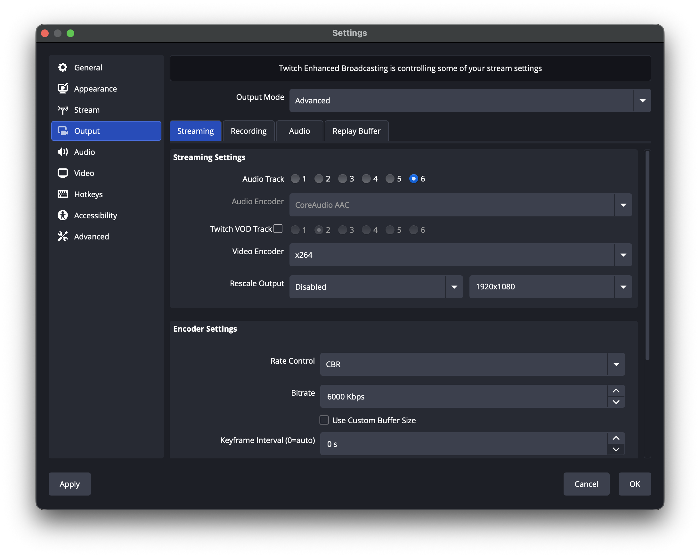

# OBS フォーラムのリソース掲載内容

> For the English version, see [forum-listing.md](forum-listing.md).

OBS フォーラムの [Mix Track to Source](https://obsproject.com/forum/resources/mix-track-to-source.2419/) リソースページの元になる内容の日本語訳。
フォーラムには英語版 ([forum-listing.md](forum-listing.md)) を掲載する。

- 説明文の「Mix Track to Source」「インストール」「使い方」の節は、リリース済みの版についての [README.ja.md](../README.ja.md) の写し。リリースで README の該当の節が変わったら、リリースを公開した後にこのファイルとフォーラムのページを更新する
- フォーラムでは、構成図は Mermaid のブロックを PNG 画像にしたものを表示している
- フォーラムでは、スクリーンショットは [img](../img) のファイルを添付して表示している

## 項目

| 項目 | 値 |
| --- | --- |
| タイトル | Mix Track to Source |
| タグ | audio, source |
| 対応ビット数 | 64-bit |
| ソースコードの URL | https://github.com/semnil/MixTrack2Source |
| OBS Studio の最小バージョン | 31.1.1 |
| 対応プラットフォーム | Windows, macOS, Linux |

## 説明文

### Mix Track to Source

- 入力にするミックストラックを選んで音声ソースを作成する
- 音声ソースは選んだミックストラックを入力とし、各種フィルタを適用できる
- 入力に選んだミックストラックを除き、ミックストラックを出力先に選べる
- バッファリングにより、最小で 1024 サンプル (48 kHz で 21 ms) の遅延が生じる
  - これ以上の遅延を許容できない場合は、OBS の 設定 > 音声 > 詳細設定 で **低遅延音声バッファリングモード (Decklink/NDI 出力用)** を有効にする

#### インストール

[Releases](https://github.com/semnil/MixTrack2Source/releases) ページからアーカイブファイルをダウンロードする。

##### Windows

**mix-track-to-source-\<version\>-windows-x64-Installer.exe** を実行してインストールする。

または、アーカイブファイルを展開し、**mix-track-to-source** フォルダを次の場所に置く:

> C:\ProgramData\obs-studio\plugins

##### macOS

**mix-track-to-source-\<version\>-macos-universal.pkg** を実行してインストールする。

##### Ubuntu

次のコマンドを実行する:

> sudo dpkg -i mix-track-to-source-\<version\>-x86_64-linux-gnu.deb

#### 使い方

- ソース追加 > ミックストラック で音声ソースを追加する
- 入力に使うミックストラックを トラック 1 から トラック 6 の中から選ぶ
- 追加した音声ソースの出力先を オーディオの詳細プロパティ ウィンドウで選ぶ
  - 入力と出力に同じトラックは選べない
  - 必要に応じて、他のソースからの出力を解除する

##### 使用例

トラック 1 の入力にリミッターを適用し、その音声を配信用にトラック 6 へ出力する設定は次のとおり:

- 音声ソースを追加するときに、入力を トラック 1 にする
- その音声ソースのフィルタにリミッターを追加する
- その音声ソースのトラック 6 への出力を有効にし、他の音声ソースのトラック 6 への出力を無効にする
- 設定 > 出力 > 配信 > 配信設定 > 音声トラック で トラック 6 を選ぶ

#### AI 利用の開示

プラグインのコード (src/plugin-main.c とロケールファイル) は、バージョン 1.0.1 まで全て AI ツールを使わずに私が設計し書いた。プラグインのコードはそれ以降変わっていない。

バージョン 1.0.2 からは、次の作業に AI ツールを補助として使っている。いずれもプラグインのコードは変えていない。

バージョン 1.0.2 では Claude Code (Anthropic) を使った:

- ビルドとパッケージ: Windows インストーラーと、ビルドスクリプトの修正
- ドキュメント: README の Windows でのインストール手順

1.0.2 より後の変更 (次のリリースに向けたもの) では Claude Code (Anthropic) を使い、OpenAI Codex でレビューしている:

- ビルドと CI: GitHub Actions のワークフロー、リリース手順、ビルドスクリプトの修正
- ドキュメント: README のリリース手順と、README の日本語訳

OpenAI Codex はこれらの変更のレビューにだけ使った。どの変更も Codex は書いていない。

AI の補助を受けたビルド・パッケージ・CI の変更は全て私自身がレビューし、リリース前にそのビルドを OBS Studio で動作確認した。AI の補助を受けたドキュメントの変更も全て私自身がレビューした。

#### 不具合の報告

不具合は GitHub Issues へ報告する: https://github.com/semnil/MixTrack2Source/issues
このリソースの議論スレッドへの投稿でも受け付ける。
