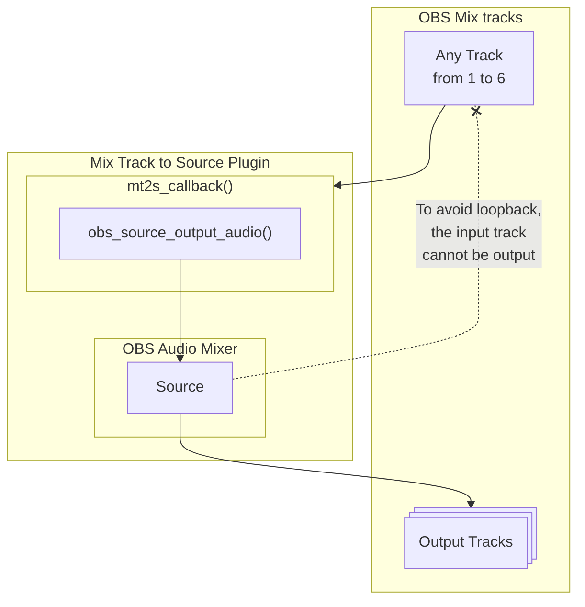
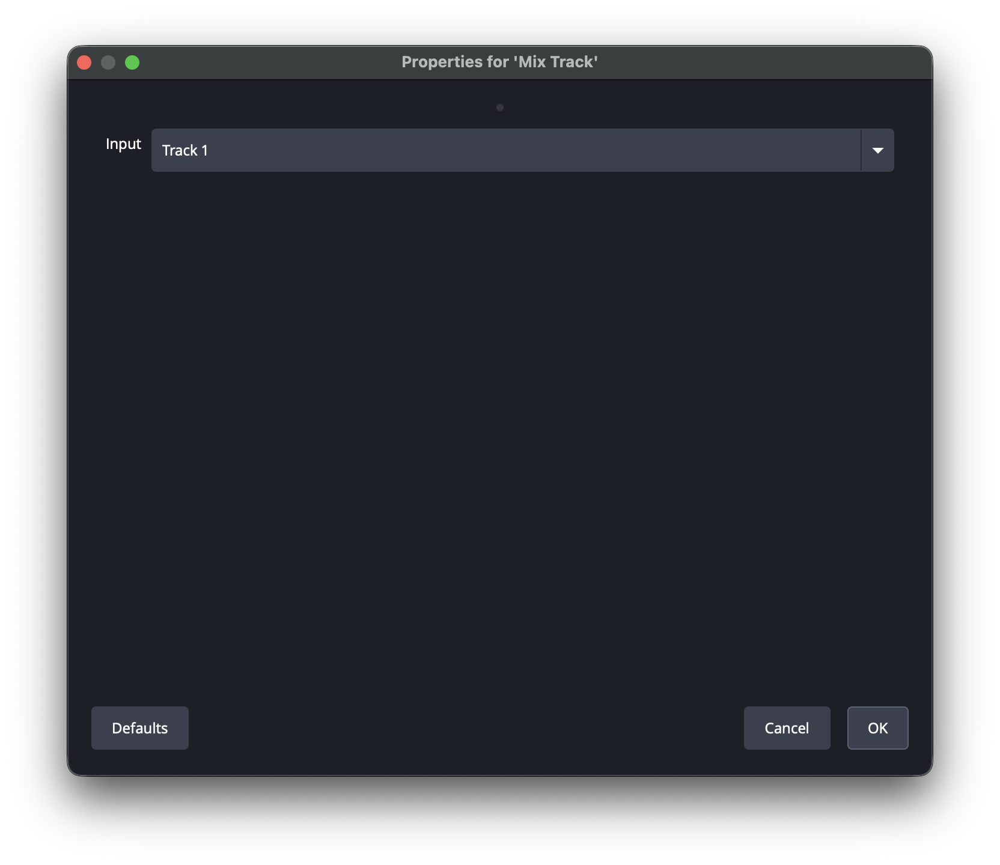
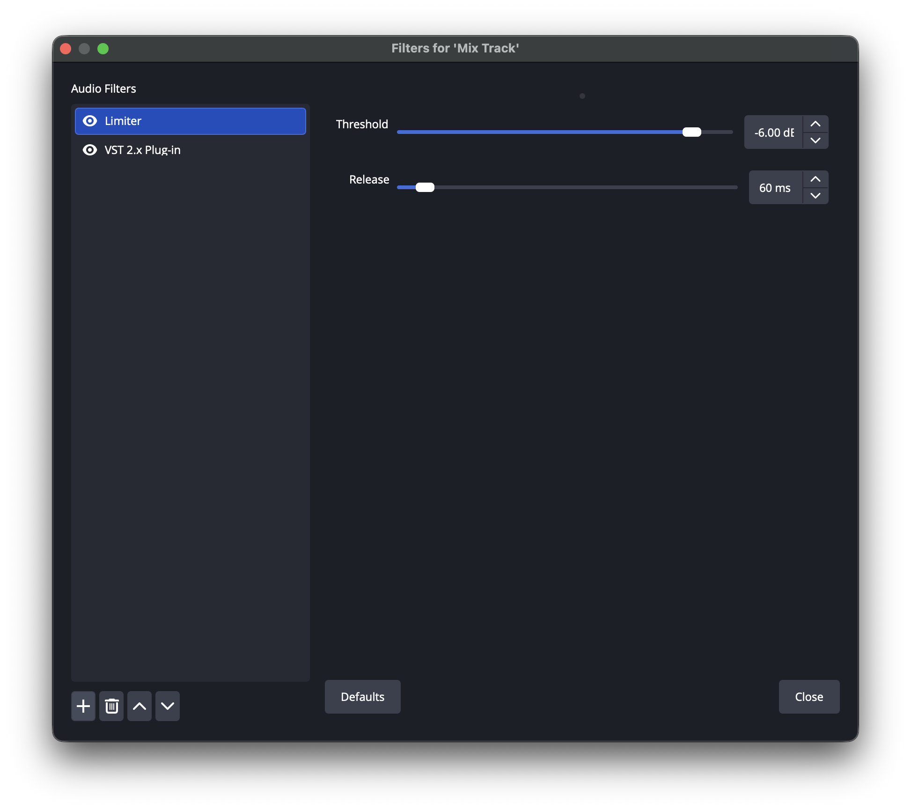
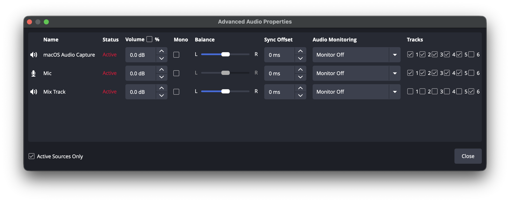
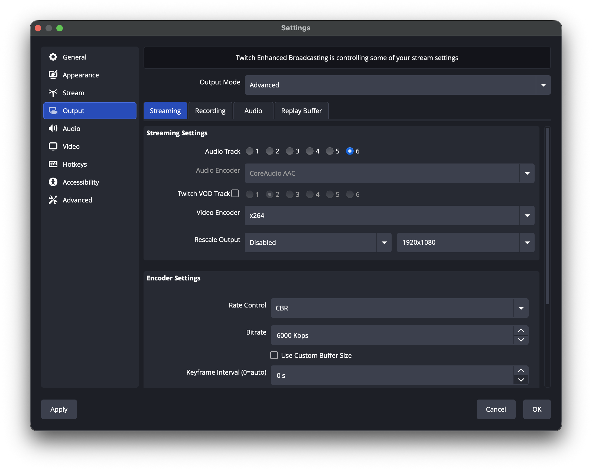

# OBS Forum Resource Listing

> 日本語版は [forum-listing.ja.md](forum-listing.ja.md) を参照してください.

This file is the source of the [Mix Track to Source](https://obsproject.com/forum/resources/mix-track-to-source.2419/) resource page on the OBS forum.
Change this file first, then enter the same content in the forum editor.

- The "Mix Track to Source", "Install", and "Usage" sections of the description are copied from [README.md](../README.md) for the released version. When a release changes those sections of README.md, update this file and the forum page after the release is published
- The forum shows the diagram as a PNG image rendered from the Mermaid block
- The forum shows the screenshots as attachments of the files in [img](../img)

## Fields

| Field | Value |
| --- | --- |
| Title | Mix Track to Source |
| Tags | audio, source |
| Supported Bit Versions | 64-bit |
| Source Code URL | https://github.com/semnil/MixTrack2Source |
| Minimum OBS Studio Version | 31.1.1 |
| Supported Platforms | Windows, macOS, Linux |

## Description

### Mix Track to Source

- Select an input mix track to create an audio source
- The audio source uses the selected mix track as input and allows various filters to be applied
- Allows selection of mix tracks as output, excluding the mix track selected as input
- Buffering causes a minimum delay of 1024 samples (21 ms at 48 kHz)
  - If even greater delay is unacceptable, enable **Low Latency Audio Buffering Mode (For Decklink/NDI outputs)** in OBS Settings > Audio > Advanced

#### Install

Please download the archive file from the [Releases](https://github.com/semnil/MixTrack2Source/releases) page.

##### Windows

Run the **mix-track-to-source-\<version\>-windows-x64-Installer.exe** file to install it.

Alternatively, extract the archive file and place the **mix-track-to-source** folder in the following location:

> C:\ProgramData\obs-studio\plugins

##### macOS

Run the **mix-track-to-source-\<version\>-macos-universal.pkg** file to install it.

##### Ubuntu

Run the following command:

> sudo dpkg -i mix-track-to-source-\<version\>-x86_64-linux-gnu.deb

#### Usage

- Add Source > Mix Track to add an audio source
- Select a mix track to use for input from Track 1 to Track 6
- Select outputs for added audio track in the Advanced Audio Properties window
  - Cannot select the same track for both input and output
  - Deselect the output from other sources as needed

##### Usage example

After applying a limiter to the input on Track 1, the settings for outputting the audio to Track 6 for distribution are as follows:

- When adding an audio source, set the input to Track 1
- Add a limiter to the filter of that audio source
- Enable the output of Track 6 for that audio source and disable the output to Track 6 for other audio sources
- Select Track 6 in Settings > Output > Streaming > Streaming Settings > Audio Track

#### AI usage disclosure

All of the plugin code (src/plugin-main.c and the locale files) was designed and written by me without AI tools, up to and including version 1.0.1. The plugin code has not changed since then.

Starting with version 1.0.2, I have used AI tools as assistants for the following. None of these changes the plugin code.

Version 1.0.2, with Claude Code (Anthropic):

- Build and packaging: the Windows installer and fixes to the build scripts
- Documentation: the Windows installation steps in the README

Changes after 1.0.2 (for the next release), with Claude Code (Anthropic), reviewed with OpenAI Codex:

- Build and CI: the GitHub Actions workflows, the release process, and a fix to the build scripts
- Documentation: the release procedure in the README and a Japanese translation of the README

OpenAI Codex was used only to review these changes. It did not write any of them.

I reviewed all AI-assisted changes to the build, packaging, and CI myself and tested the resulting builds in OBS Studio before releasing them. I reviewed all AI-assisted documentation changes myself.

#### Reporting bugs

Please report bugs on GitHub Issues: https://github.com/semnil/MixTrack2Source/issues
You can also post in the discussion thread of this resource.
