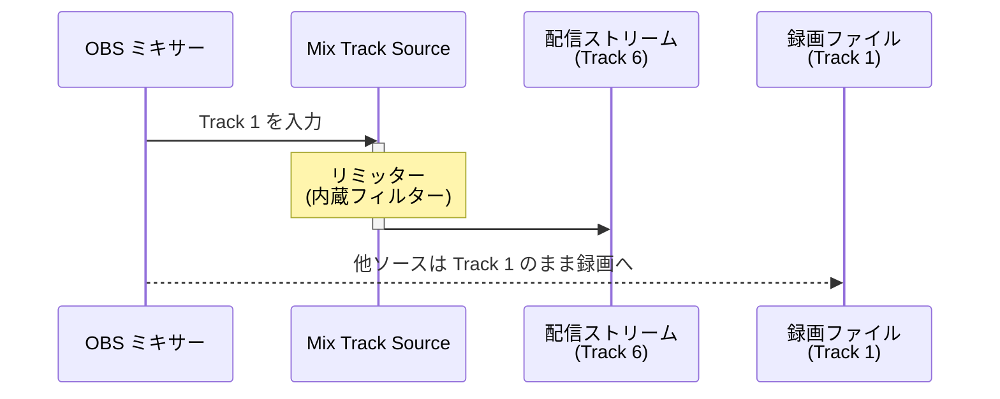

# 使用例 1 — 配信用マスタリミッター

> For the English version, see [uc1-master-limiter.md](uc1-master-limiter.md).

配信に流す前の全体ミックスにリミッターを適用しつつ、ローカル録画には未処理のミックスをそのまま残す。

## ルーティング

## OBS 設定チェックリスト

| 場所 | 設定 |
|---|---|
| ソースを追加 | **Mix Track** を追加 → 入力 = **Track 1** |
| ソース › フィルター | Mix Track Source に **リミッター** を追加 |
| 詳細音声プロパティ（Mix Track Source） | Track 1 **☐**、Track 6 **☑** |
| 詳細音声プロパティ（その他すべてのソース） | Track 1 **☑**、Track 6 **☐** |
| 設定 › 出力 › 配信 | 音声トラック = **6** |
| 設定 › 出力 › 録画 | Track 1 **☑** |

## 補足

- 配信トラックのみリミットがかかるため、録画と配信で音量特性を独立して管理できる。
- 最小遅延は **1,024 サンプル**（48 kHz で約 21 ms）。許容できない場合は 設定 › 音声 › 詳細 の **低遅延バッファリングモード** を有効にする。
- 録画トラックには未処理のミックスが収録されるため、後からリマスタリングが可能。
