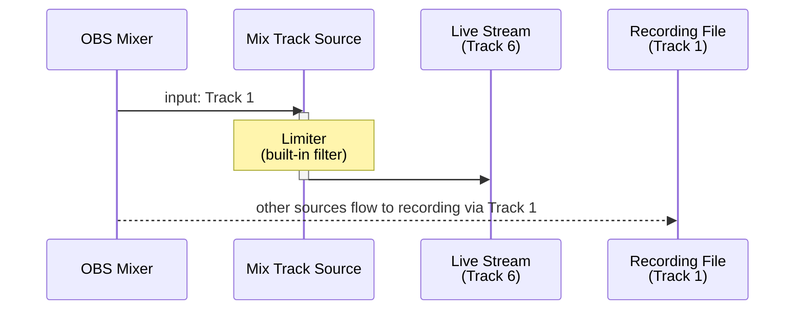

# Use Case 1 — Master Limiter for Streaming

> 日本語版は [uc1-master-limiter.ja.md](uc1-master-limiter.ja.md) を参照してください.

Apply a limiter to the full mix before it reaches the stream, while keeping the unprocessed mix
intact for local recording.

## Routing

## OBS Settings Checklist

| Location | Setting |
|---|---|
| Add Source | Add **Mix Track** → Input = **Track 1** |
| Source › Filters | Add a **Limiter** to Mix Track Source |
| Advanced Audio Properties (Mix Track Source) | Track 1 **☐**, Track 6 **☑** |
| Advanced Audio Properties (all other sources) | Track 1 **☑**, Track 6 **☐** |
| Settings › Output › Streaming | Audio Track = **6** |
| Settings › Output › Recording | Track 1 **☑** |

## Notes

- Mix Track Source turns Track 6 off by itself on the other sources that send audio to Track 1 (see
  [README.md](../README.md) for when it does), so the Track 6 setting of those sources in the
  checklist needs no manual step.
- Only the stream track is limited, so loudness characteristics for the recording and the stream
  can be managed independently.
- Minimum latency introduced: **1,024 samples** (~21 ms at 48 kHz). Enable
  **Low Latency Audio Buffering Mode (For Decklink/NDI outputs)** in Settings › Audio › Advanced if this is unacceptable.
- The recording track retains the unprocessed mix, leaving it available for re-mastering later.
