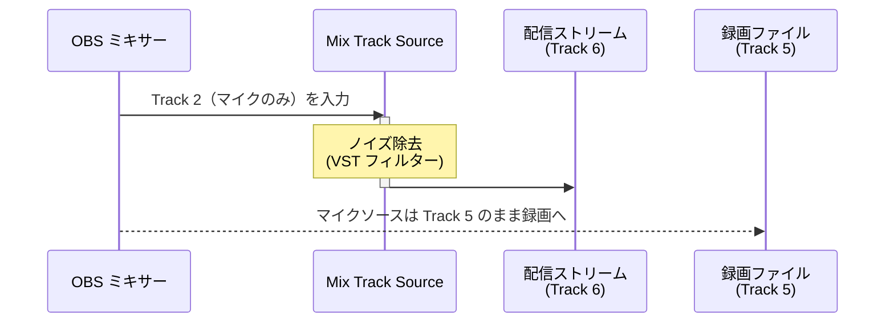

# 使用例 2 — マイクへのノイズ除去（VST フィルター）

> For the English version, see [uc2-vst-noise-removal.md](uc2-vst-noise-removal.md).

マイクトラックにノイズ除去処理を適用して配信に流しつつ、録画には生のマイク音声を別トラックとして保持する。

## ルーティング

## OBS 設定チェックリスト

| 場所 | 設定 |
|---|---|
| ソースを追加 | **Mix Track** を追加 → 入力 = **Track 2** |
| ソース › フィルター | Mix Track Source に **VST プラグイン**（ノイズ除去系）を追加 |
| VST プラグイン UI | ノイズプロファイルを取得してノイズ除去モードを有効化 |
| 詳細音声プロパティ（Mix Track Source） | Track 2 **☐**、Track 6 **☑** |
| 詳細音声プロパティ（マイクソース） | Track 2 **☑**、Track 5 **☑** |
| 詳細音声プロパティ（その他すべてのソース） | Track 2 **☐**、Track 6 **☐** |
| 設定 › 出力 › 配信 | 音声トラック = **6** |
| 設定 › 出力 › 録画 | Track 5 **☑** |

## 補足

- OBS は VST 2 プラグインを標準でロードする。VST 3 のサポートは OBS 30 以降。
- 録画の Track 5 には生のマイク信号が残るため、後から DAW で任意のノイズ処理をかけ直せる。
- VST が目立つ遅延を生じさせる場合は、映像キャプチャソースの詳細音声プロパティで **同期オフセット** を設定して補正する。
