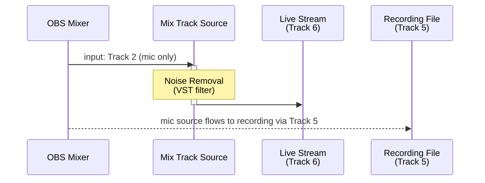

# Use Case 2 — Noise Removal on Microphone (VST Filter)

> 日本語版は [uc2-vst-noise-removal.ja.md](uc2-vst-noise-removal.ja.md) を参照してください.

Apply noise-reduction processing to the microphone track for streaming, while preserving the raw
microphone audio on a separate recording track for post-production.

## Routing

## OBS Settings Checklist

| Location | Setting |
|---|---|
| Add Source | Add **Mix Track** → Input = **Track 2** |
| Source › Filters | Add a **VST plug-in** (noise-reduction type) to Mix Track Source |
| VST plug-in UI | Capture a noise profile and enable noise-reduction mode |
| Advanced Audio Properties (Mix Track Source) | Track 2 **☐**, Track 6 **☑** |
| Advanced Audio Properties (microphone source) | Track 2 **☑**, Track 5 **☑** |
| Advanced Audio Properties (all other sources) | Track 2 **☐**, Track 5 **☐**, Track 6 **☐** |
| Settings › Output › Streaming | Audio Track = **6** |
| Settings › Output › Recording | Track 5 **☑** |

## Notes

- Mix Track Source turns Track 6 off by itself on the microphone source, which sends audio to Track
  2 (see [README.md](../README.md) for when it does). The other sources do not send audio to Track
  2, so turn their Track 6 off by hand.
- OBS loads VST 2 plug-ins with its **VST 2.x Plug-in** filter.
- Recording Track 5 retains the raw microphone signal, allowing noise reduction to be applied or
  adjusted offline in a DAW later.
- If the VST introduces noticeable latency, add a **Render Delay** filter to the video source and
  set it to the VST's processing latency, so that the video stays in sync with the processed audio.
