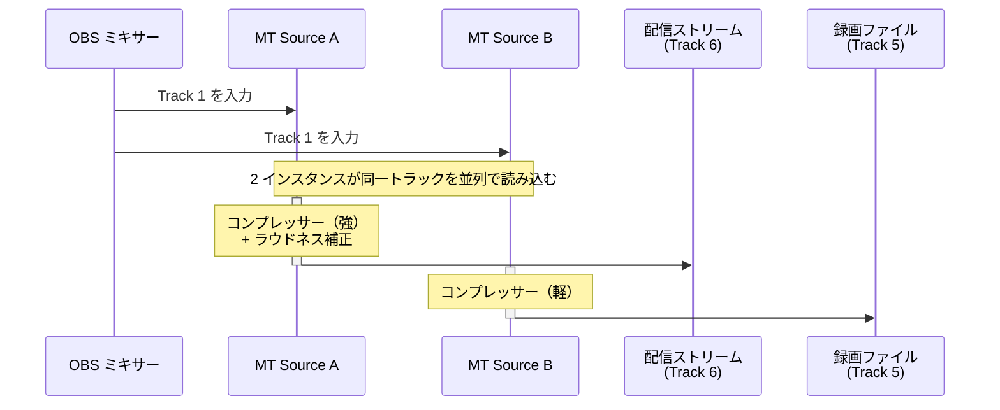

# 使用例 3 — 配信と録画でコンプレッサー設定を分岐

> For the English version, see [uc3-dual-instance-comp.md](uc3-dual-instance-comp.md).

同一のミックストラックを 2 つの Mix Track Source インスタンスで読み込み、それぞれに異なるフィルターチェーンを持たせることで、配信と録画で別々の音声処理を実現する。

## ルーティング

## OBS 設定チェックリスト

| 場所 | 設定 |
|---|---|
| ソースを追加 | **Mix Track** を 2 回追加 → それぞれ *MT Source A*、*MT Source B* と命名 |
| MT Source A | 入力 = **Track 1** |
| MT Source B | 入力 = **Track 1** |
| MT Source A › フィルター | コンプレッサー（高レシオ）+ ラウドネス系フィルター |
| MT Source B › フィルター | コンプレッサー（低レシオ）またはフィルターなし |
| 詳細音声プロパティ（MT Source A） | Track 1 **☐**、Track 5 **☐**、Track 6 **☑** |
| 詳細音声プロパティ（MT Source B） | Track 1 **☐**、Track 5 **☑**、Track 6 **☐** |
| 詳細音声プロパティ（その他すべてのソース） | Track 1 **☑**、Track 5 **☐**、Track 6 **☐** |
| 設定 › 出力 › 配信 | 音声トラック = **6** |
| 設定 › 出力 › 録画 | Track 5 **☑** |

## 補足

- 生音のアーカイブも残したい場合は、録画タブで Track 1 も ☑ にし、その他のソースが Track 1 への出力を維持していることを確認する。
- CPU 負荷はインスタンス数に比例するが、軽量なフィルターチェーン 2 本であれば通常は問題ない。
