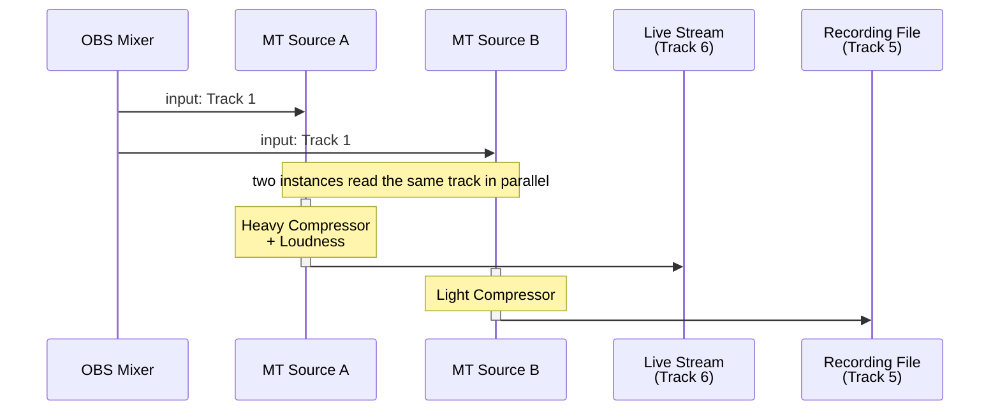

# Use Case 3 — Separate Compression for Streaming vs. Recording

> 日本語版は [uc3-dual-instance-comp.ja.md](uc3-dual-instance-comp.ja.md) を参照してください.

Use two independent Mix Track Source instances reading the same mix track. Each instance carries
a different filter chain so the stream and the recording file receive differently processed audio.

## Routing

## OBS Settings Checklist

| Location | Setting |
|---|---|
| Add Source | Add **Mix Track** twice — name them *MT Source A* and *MT Source B* |
| MT Source A | Input = **Track 1** |
| MT Source B | Input = **Track 1** |
| MT Source A › Filters | Compressor (high ratio) + loudness-type filter |
| MT Source B › Filters | Compressor (low ratio) or no filter |
| Advanced Audio Properties (MT Source A) | Track 1 **☐**, Track 5 **☐**, Track 6 **☑** |
| Advanced Audio Properties (MT Source B) | Track 1 **☐**, Track 5 **☑**, Track 6 **☐** |
| Advanced Audio Properties (all other sources) | Track 1 **☑**, Track 5 **☐**, Track 6 **☐** |
| Settings › Output › Streaming | Audio Track = **6** |
| Settings › Output › Recording | Track 5 **☑** |

## Notes

- To keep an unprocessed archive, also enable Track 1 in the recording output and confirm that
  other sources still have Track 1 output enabled.
- CPU overhead scales linearly with the number of instances; two lightweight filter chains add
  negligible load in practice.
