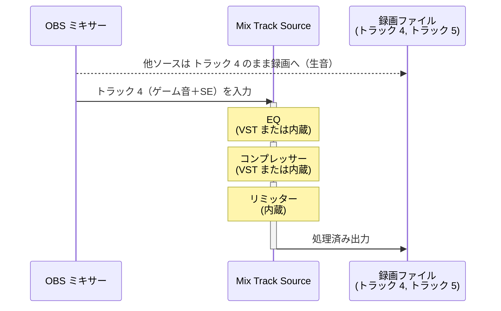

# 使用例 4 — EQ・コンプレッサー・リミッターのフィルターチェーンと 2 トラック同時録画

> For the English version, see [uc4-eq-comp-limiter-chain.md](uc4-eq-comp-limiter-chain.md).

単一の Mix Track Source にフィルターを直列に積み、EQ → コンプレッサー → リミッターの順で処理する。生音（トラック 4）と処理済み音（トラック 5）を同時に録画し、編集時にどちらでも使えるようにする。

## ルーティング

## フィルターチェーンの順序

OBS のフィルターダイアログではリストの上から下の順に処理される。

| スロット | フィルター | 役割 |
|---|---|---|
| 1 | **EQ**（VST または内蔵） | 周波数バランスを整える |
| 2 | **コンプレッサー**（VST または内蔵） | ダイナミクスを制御する |
| 3 | **リミッター**（内蔵） | クリッピングを防ぐ安全弁として最後に配置 |

## OBS 設定チェックリスト

| 場所 | 設定 |
|---|---|
| ソースを追加 | **ミックストラック** を追加 → 入力 = **トラック 4** |
| ソース › フィルタ | EQ → コンプレッサー → リミッターの順で追加 |
| オーディオの詳細プロパティ（Mix Track Source） | トラック 4 **☐**、トラック 5 **☑** |
| オーディオの詳細プロパティ（ゲーム音ソース） | トラック 4 **☑**、トラック 5 **☐** |
| オーディオの詳細プロパティ（その他すべてのソース） | トラック 4 **☐**、トラック 5 **☐** |
| 設定 › 出力 › 録画 | トラック 4 **☑**、トラック 5 **☑** |

## 補足

- Mix Track Source は、トラック 4 へ音声を送るゲーム音ソースのトラック 5 を自動で外す (行うタイミングは [README.ja.md](../README.ja.md) を参照)。その他のソースはトラック 4 へ音声を送らないので、トラック 5 は手で外す。
- リミッターを最後に置くことで、EQ やコンプレッサーの調整がどれだけ積極的であってもクリッピングが発生しない。
- トラック 4（生音）はポストプロダクションでの再処理に適しており、トラック 5（処理済み）はそのまま動画編集に使用できる。
