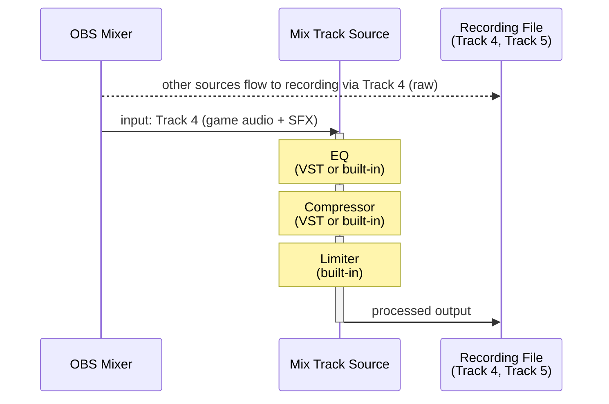

# Use Case 4 — EQ, Compressor, and Limiter Chain with Dual-Track Recording

> 日本語版は [uc4-eq-comp-limiter-chain.ja.md](uc4-eq-comp-limiter-chain.ja.md) を参照してください.

Stack filters in series on a single Mix Track Source — EQ → Compressor → Limiter — and record
both the raw signal (Track 4) and the processed signal (Track 5) simultaneously so the editor
can use either version in post-production.

## Routing

## Filter Chain Order

Filters are applied top-to-bottom in the OBS Filters dialog.

| Slot | Filter | Purpose |
|---|---|---|
| 1 | **EQ** (VST or built-in) | Shape the frequency balance |
| 2 | **Compressor** (VST or built-in) | Control dynamics |
| 3 | **Limiter** (built-in) | Final safety ceiling to prevent clipping |

## OBS Settings Checklist

| Location | Setting |
|---|---|
| Add Source | Add **Mix Track** → Input = **Track 4** |
| Source › Filters | Add filters in order: EQ → Compressor → Limiter |
| Advanced Audio Properties (Mix Track Source) | Track 4 **☐**, Track 5 **☑** |
| Advanced Audio Properties (game audio source) | Track 4 **☑**, Track 5 **☐** |
| Advanced Audio Properties (all other sources) | Track 4 **☐**, Track 5 **☐** |
| Settings › Output › Recording | Track 4 **☑**, Track 5 **☑** |

## Notes

- Mix Track Source turns Track 5 off by itself on the game audio source, which sends audio to Track
  4 (see [README.md](../README.md) for when it does). The other sources do not send audio to Track
  4, so turn their Track 5 off by hand.
- Placing the limiter last ensures clipping cannot occur regardless of how aggressively the EQ or
  compressor is set.
- Track 4 (raw) is suited for offline re-processing; Track 5 (processed) is ready for immediate
  use in a video edit without further treatment.
