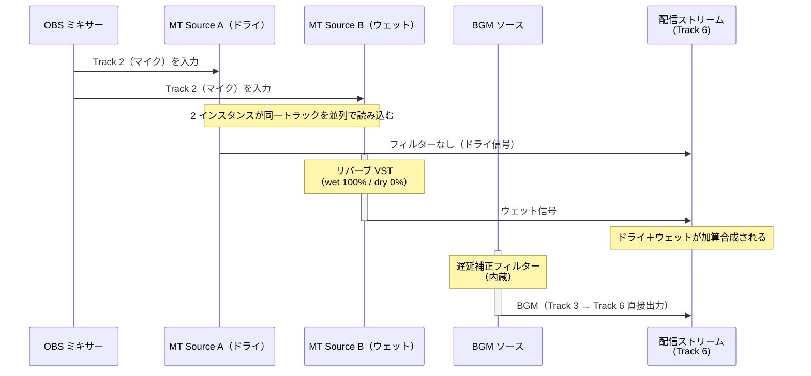

# 使用例 5 — パラレルリバーブ（歌枠・配信用 on/off 対応）

> For the English version, see [uc5-parallel-reverb.md](uc5-parallel-reverb.md).

マイクトラックを 2 つの Mix Track Source インスタンスで読み込み、一方をドライ信号、もう一方をウェット専用のリバーブ信号として出力する。カラオケ BGM は別トラックから直接配信トラックに出力し、リバーブの影響を受けないようにする。MT Source B をミュートするだけでボーカルのリバーブを即時 on/off できるため、歌枠での楽曲ごとの切り替えに適している。

## トラック割り当て

| トラック | 内容 |
|---|---|
| Track 2 | マイク（ボーカル）専用 |
| Track 3 | カラオケ BGM 専用 |
| Track 6 | 配信出力（ボーカル ドライ＋ウェット加算＋BGM） |

## ルーティング

## on/off の切り替え方法

| 操作 | 結果 |
|---|---|
| MT Source B を**ミュート** | ドライボーカルのみ配信（リバーブ off） |
| MT Source B を**ミュート解除** | ドライ＋ウェット配信（リバーブ on） |

ミュートボタンはオーディオミキサーパネルで即時操作できる。MT Source A は常時有効のままにしておくことで、リバーブ off 時もボーカルが途切れない。BGM はいずれの状態でも影響を受けない。

## BGM の遅延補正

リバーブ VST はバッファリング処理により数ミリ秒〜数十ミリ秒の遅延を導入する。MT Source A（ドライ）と MT Source B（ウェット）は同一の入力バスを経由するため互いに同期しているが、BGM ソースはリバーブ処理を経由しないため VST の遅延分だけ早く配信に到達する。これを補正しないとボーカルの歌い出しが BGM に対して遅れて聴こえる。

BGM ソースに内蔵の**遅延補正フィルター**を追加し、遅延量（ms）を VST の処理遅延に合わせて設定する。

**遅延量の計測手順：**

1. テスト音（クリック音など）をマイクから一発入力する
2. OBS の映像を録画または配信遅延なしでモニタリングし、ドライ信号とウェット信号の到達タイミング差を確認する
3. 差分（ms）を BGM ソースの遅延補正フィルターに設定する

多くのリバーブ VST は処理遅延を仕様として公開している場合があるため、プラグインのドキュメントも参照する。

## OBS 設定チェックリスト

| 場所 | 設定 |
|---|---|
| ソースを追加 | **Mix Track** を 2 回追加 → それぞれ *MT Source A*、*MT Source B* と命名 |
| MT Source A | 入力 = **Track 2** |
| MT Source B | 入力 = **Track 2** |
| MT Source A › フィルター | なし |
| MT Source B › フィルター | **リバーブ VST** を追加 → dry = **0%**、wet = **100%** に設定 |
| BGM ソース › フィルター | **遅延補正**を追加 → 遅延量（ms）= VST の処理遅延に合わせて設定 |
| 詳細音声プロパティ（MT Source A） | Track 2 **☐**、Track 6 **☑** |
| 詳細音声プロパティ（MT Source B） | Track 2 **☐**、Track 6 **☑** |
| 詳細音声プロパティ（マイクソース） | Track 2 **☑**、Track 6 **☐** |
| 詳細音声プロパティ（BGM ソース） | Track 3 **☑**、Track 6 **☑** |
| 詳細音声プロパティ（その他すべてのソース） | Track 2 **☐**、Track 3 **☐**、Track 6 **☐** |
| MT Source A 音量フェーダー | ドライボーカル量を調整 |
| MT Source B 音量フェーダー | ウェット量（リバーブの返し量）を調整 |
| 設定 › 出力 › 配信 | 音声トラック = **6** |

## 補足

- BGM ソースの Track 6 出力を直接有効にすることで、リバーブ処理を経由せず BGM がクリーンに配信される。
- ドライとウェットの音量比はフェーダーで独立して調整できる。楽曲に合わせてウェット量をあらかじめ設定しておき、ミュートで切り替えるだけで運用できる。
- リバーブ VST が dry/wet を独立して制御できることが前提となる。wet 出力のみを取り出す設定（wet 100% / dry 0%）に対応していないプラグインではドライ信号が二重になるため使用できない。
- 録画にも同じミックスを残す場合は、MT Source A・B および BGM ソースの詳細音声プロパティで Track 5 を追加 ☑ し、設定 › 出力 › 録画で Track 5 を ☑ にする。
