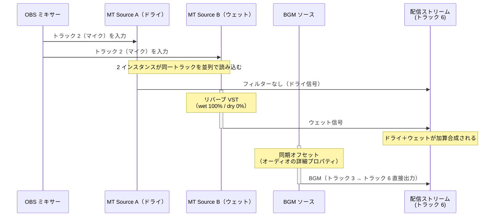

# 使用例 5 — パラレルリバーブ（歌枠・配信用 on/off 対応）

> For the English version, see [uc5-parallel-reverb.md](uc5-parallel-reverb.md).

マイクトラックを 2 つの Mix Track Source インスタンスで読み込み、一方をドライ信号、もう一方をウェット専用のリバーブ信号として出力する。カラオケ BGM は別トラックから直接配信トラックに出力し、リバーブの影響を受けないようにする。MT Source B をミュートするだけでボーカルのリバーブを即時 on/off できるため、歌枠での楽曲ごとの切り替えに適している。

## トラック割り当て

| トラック | 内容 |
|---|---|
| トラック 2 | マイク（ボーカル）専用 |
| トラック 3 | カラオケ BGM 専用 |
| トラック 6 | 配信出力（ボーカル ドライ＋ウェット加算＋BGM） |

## ルーティング

## on/off の切り替え方法

| 操作 | 結果 |
|---|---|
| MT Source B を**ミュート** | ドライボーカルのみ配信（リバーブ off） |
| MT Source B を**ミュート解除** | ドライ＋ウェット配信（リバーブ on） |

ミュートボタンは音声ミキサーで即時操作できる。MT Source A は常時有効のままにしておくことで、リバーブ off 時もボーカルが途切れない。BGM はいずれの状態でも影響を受けない。

## BGM の遅延補正

ボーカルは MT Source A と MT Source B を通ってだけ配信に届く。この 2 つは、トラック 6 へ直接出力するソースよりも、Mix Track Source のバッファリングの分 (最小で 1,024 サンプル、48 kHz で約 21 ms) 遅れて出力する。MT Source B は、さらにリバーブ VST の処理遅延の分だけ遅れる。BGM ソースは直接出力するため、補正しないとボーカルの歌い出しが BGM に対して遅れて聴こえる。

BGM ソースの、オーディオの詳細プロパティの **同期オフセット** を、ドライのボーカルと BGM のずれに合わせて設定する。

**ずれの計測手順：**

1. テスト音（クリック音など）をマイクから一発入力する
2. 出力をモニタリングまたは録画し、ドライのボーカルと BGM の到達タイミング差を確認する
3. 差分（ms）を BGM ソースの同期オフセットに設定する

## OBS 設定チェックリスト

| 場所 | 設定 |
|---|---|
| ソースを追加 | **ミックストラック** を 2 回追加 → それぞれ *MT Source A*、*MT Source B* と命名 |
| MT Source A | 入力 = **トラック 2** |
| MT Source B | 入力 = **トラック 2** |
| MT Source A › フィルタ | なし |
| MT Source B › フィルタ | **リバーブ VST** を追加 → dry = **0%**、wet = **100%** に設定 |
| オーディオの詳細プロパティ（BGM ソース） | 同期オフセット（ms）= 計測したドライのボーカルと BGM のずれ |
| オーディオの詳細プロパティ（MT Source A） | トラック 2 **☐**、トラック 6 **☑** |
| オーディオの詳細プロパティ（MT Source B） | トラック 2 **☐**、トラック 6 **☑** |
| オーディオの詳細プロパティ（マイクソース） | トラック 2 **☑**、トラック 6 **☐** |
| オーディオの詳細プロパティ（BGM ソース） | トラック 3 **☑**、トラック 6 **☑** |
| オーディオの詳細プロパティ（その他すべてのソース） | トラック 2 **☐**、トラック 3 **☐**、トラック 6 **☐** |
| MT Source A 音量フェーダー | ドライボーカル量を調整 |
| MT Source B 音量フェーダー | ウェット量（リバーブの返し量）を調整 |
| 設定 › 出力 › 配信 | 音声トラック = **6** |

## 補足

- MT Source A と MT Source B は、トラック 2 へ音声を送るマイクソースのトラック 6 を自動で外す (行うタイミングは [README.ja.md](../README.ja.md) を参照)。BGM ソースはトラック 2 へ音声を送らないので、トラック 6 はオンのまま。その他のソースのトラック 6 は手で外す。
- BGM ソースの トラック 6 出力を直接有効にすることで、リバーブ処理を経由せず BGM がクリーンに配信される。
- ドライとウェットの音量比はフェーダーで独立して調整できる。楽曲に合わせてウェット量をあらかじめ設定しておき、ミュートで切り替えるだけで運用できる。
- リバーブ VST が dry/wet を独立して制御できることが前提となる。wet 出力のみを取り出す設定（wet 100% / dry 0%）に対応していないプラグインではドライ信号が二重になるため使用できない。
- 録画にも同じミックスを残す場合は、MT Source A・B および BGM ソースのオーディオの詳細プロパティで トラック 5 を追加 ☑ し、設定 › 出力 › 録画で トラック 5 を ☑ にする。
