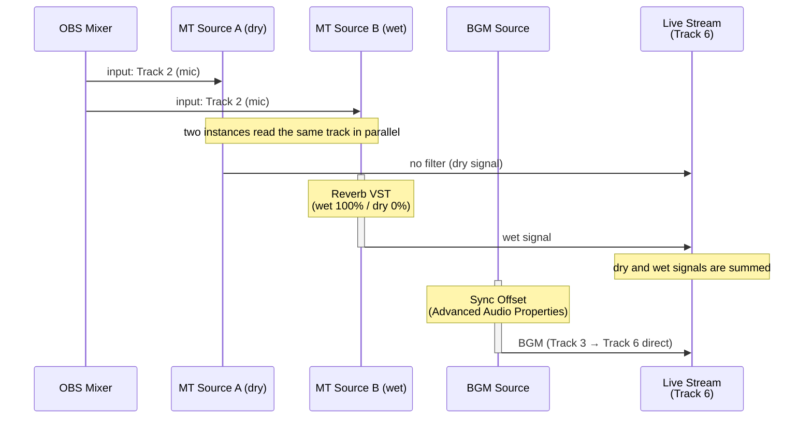

# Use Case 5 — Parallel Reverb (Singing Stream, Live on/off)

> 日本語版は [uc5-parallel-reverb.ja.md](uc5-parallel-reverb.ja.md) を参照してください.

Read the microphone track with two Mix Track Source instances — one carrying the dry signal
unmodified, the other carrying a wet-only reverb signal. The karaoke BGM is routed directly
to the stream track from a separate track, keeping it free of any reverb processing. Muting
MT Source B removes the vocal reverb instantly, making this well suited to singing streams
where reverb needs to be toggled per song.

## Track Assignment

| Track | Content |
|---|---|
| Track 2 | Microphone (vocal) only |
| Track 3 | Karaoke BGM only |
| Track 6 | Stream output (vocal dry + wet sum + BGM) |

## Routing

## on/off Toggle

| Action | Result |
|---|---|
| **Mute** MT Source B | Dry vocal only (reverb off) |
| **Unmute** MT Source B | Dry + wet vocal (reverb on) |

The mute button is accessible at any time in the Audio Mixer panel. Keeping MT Source A active
at all times ensures the dry vocal is never interrupted when toggling reverb off. The BGM is
unaffected in either state.

## BGM Delay Compensation

The vocal reaches the stream only through MT Source A and MT Source B, which output it later than
a source routed directly to Track 6, by the buffering of Mix Track Source (at least 1,024
samples, about 21 ms at 48 kHz). MT Source B adds the processing latency of the reverb VST on
top of that. The BGM source is routed directly, so without compensation the vocal onset sounds
late relative to the BGM.

Set the **Sync Offset** of the BGM source in Advanced Audio Properties to the offset between the
dry vocal and the BGM.

**Measuring the offset:**

1. Feed a single test impulse (e.g. a click) through the microphone.
2. Monitor or record the output and observe the timing offset between the dry vocal signal and
   the BGM.
3. Set that difference (ms) as the Sync Offset of the BGM source.

## OBS Settings Checklist

| Location | Setting |
|---|---|
| Add Source | Add **Mix Track** twice — name them *MT Source A* and *MT Source B* |
| MT Source A | Input = **Track 2** |
| MT Source B | Input = **Track 2** |
| MT Source A › Filters | None |
| MT Source B › Filters | Add a **Reverb VST** → set dry = **0%**, wet = **100%** |
| Advanced Audio Properties (BGM source) | Sync Offset (ms) = measured offset between the dry vocal and the BGM |
| Advanced Audio Properties (MT Source A) | Track 2 **☐**, Track 6 **☑** |
| Advanced Audio Properties (MT Source B) | Track 2 **☐**, Track 6 **☑** |
| Advanced Audio Properties (microphone source) | Track 2 **☑**, Track 6 **☐** |
| Advanced Audio Properties (BGM source) | Track 2 **☐**, Track 3 **☑**, Track 6 **☑** |
| Advanced Audio Properties (all other sources) | Track 2 **☐**, Track 3 **☐**, Track 6 **☐** |
| MT Source A volume fader | Adjust dry vocal level |
| MT Source B volume fader | Adjust wet level (reverb send amount) |
| Settings › Output › Streaming | Audio Track = **6** |

## Notes

- MT Source A and MT Source B turn Track 6 off by themselves on the microphone source, which sends
  audio to Track 2 (see [README.md](../README.md) for when it does). The BGM source does not send
  audio to Track 2, so its Track 6 stays on. Turn Track 6 off by hand on the other sources.
- Enabling Track 6 directly on the BGM source routes it to the stream without passing through
  any reverb processing, keeping the backing track clean.
- The dry/wet balance is controlled independently by each source's volume fader. Set the wet
  level in advance for each song and simply mute/unmute to toggle during the stream.
- This use case requires a reverb VST that can output wet signal only (wet 100% / dry 0%).
  A plug-in that cannot isolate the wet output will double the dry signal and is not suitable.
- To also capture the blend in the recording, enable Track 5 on MT Source A, MT Source B, and
  the BGM source in Advanced Audio Properties, turn Track 5 off on all the other sources,
  including the microphone source, and enable Track 5 in Settings › Output › Recording.
